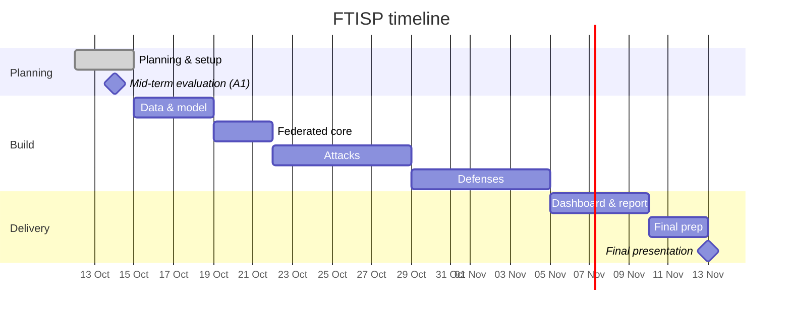

# Project Timeline — FTISP

**Start:** Mon 12 Oct 2026 · **Mid-term evaluation (A1):** Wed 14 Oct 2026 · **Final presentation:** week of 9–13 Nov 2026 (date TBC)

## Phases

| Phase | Dates | Work | Deliverable / exit criterion |
|---|---|---|---|
| **0. Planning & setup** | 12–14 Oct | Problem definition, threat model, architecture, repo scaffold | Synopsis, timeline, responsibility matrix; mid-term presentation |
| **1. Data & model** | 15–18 Oct | UNSW-NB15 loader + preprocessing; Dirichlet/shard non-IID partitioning; MLP classifier; local training | One client trains and evaluates locally; partition statistics plotted |
| **2. Federated core** | 19–21 Oct | Server orchestrator, client workers, FedAvg, per-round logging | Convergence plot: IID vs non-IID |
| **3. Attacks** | 22–28 Oct | Label-flip + update-scaling poisoning; membership-inference attack | Accuracy-collapse plot; MIA ROC curve |
| **4. Defenses** | 29 Oct–4 Nov | Median, trimmed-mean, Krum; DP (clip + noise); secure aggregation (X25519 + masking) | Robustness curve vs malicious fraction; DP trade-off curve; secure-agg correctness tests |
| **5. Dashboard & report** | 5–9 Nov | FastAPI + WebSocket + Chart.js dashboard; full experiment run; report | Live demo; all result figures; draft report |
| **6. Final prep** | 10–12 Nov | Slides, demo script, rehearsal, buffer | Final presentation |

## Gantt

## Milestones

| # | Milestone | Target |
|---|---|---|
| M1 | Mid-term: problem, threat model, methodology approved | 14 Oct |
| M2 | Federated training converges on non-IID data | 21 Oct |
| M3 | Both attacks demonstrated with measurable impact | 28 Oct |
| M4 | All defenses implemented and evaluated | 4 Nov |
| M5 | Dashboard live; all experiments reproducible from one command | 9 Nov |
| M6 | Final presentation | week of 9–13 Nov |

## Status

Phases 0–5 are implemented and measured (poisoning, robust aggregation, DP, membership inference,
secure aggregation, dashboard). What remains is the report, the final deck, and the stretch
attacks. Figures and numbers: [`../results/README.md`](../results/README.md).

## Scope control

If the schedule slips, work is cut from the bottom up. The **must** tier alone is a complete
project.

- **Must:** data pipeline, FL loop, poisoning attack, robust aggregation, result plots
- **Should:** DP, membership inference, secure aggregation, dashboard
- **Stretch:** backdoor attack, gradient-leakage (DLG) reconstruction
